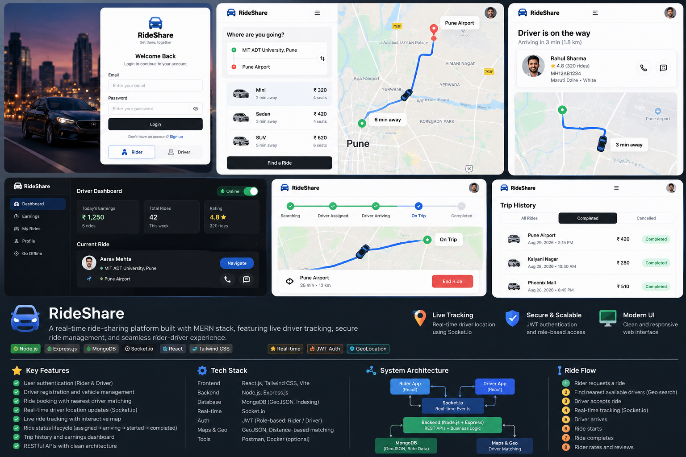
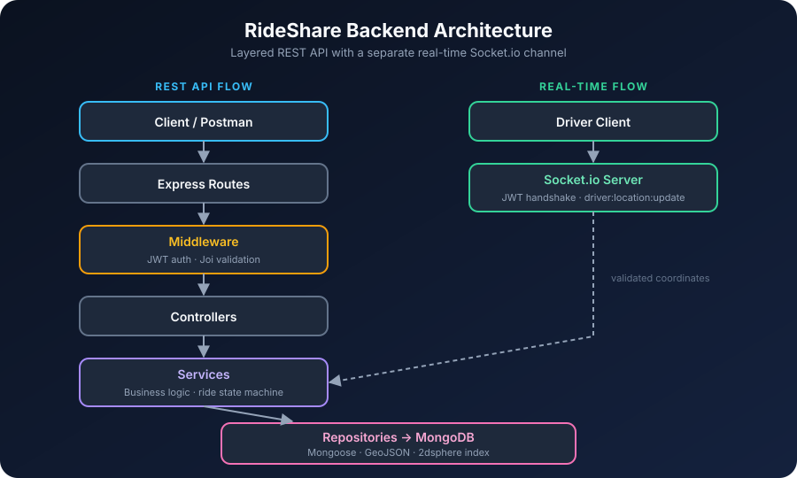
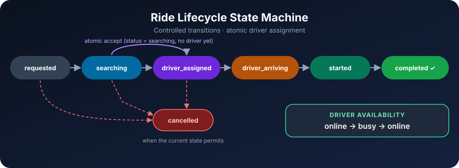

<div align="center">

# 🚗 RideShare — Real-Time Ride-Sharing Platform

### Find a ride fast. Track your driver live. Reach your destination on time.

A ride-sharing backend featuring geospatial driver discovery, atomic ride assignment and real-time location updates.


</div>

---

## 🖼️ UI Preview

<div align="center">
  
  <br>
  <sub>Design preview of the planned rider and driver interface. This repository currently contains the backend that powers it.</sub>
</div>

## 📖 Overview

RideShare is a ride-sharing backend built with **Node.js, Express.js, MongoDB and Socket.io**. It manages rider authentication, driver and vehicle registration, ride booking, nearby-driver discovery and real-time location updates.

The project focuses on **clean backend architecture, geospatial queries, secure API design and reliable ride lifecycle management**.

## ✨ Key Features

| | Feature | Description |
|---|---|---|
| 🔐 | **Authentication & authorization** | JWT-based auth, bcrypt password hashing and role-based user management |
| 🧑 | **Rider management** | Registration, login, profile retrieval, updates and account deletion |
| 🚘 | **Driver onboarding** | Driver profiles, licence details, approval status, availability and location |
| 🚙 | **Vehicle management** | Registration details, insurance information, vehicle types and capacity |
| 📍 | **Ride booking** | Create rides with pickup and destination coordinates |
| 🧭 | **Nearby driver discovery** | MongoDB geospatial queries using GeoJSON and `2dsphere` indexes |
| 🔒 | **Atomic ride assignment** | Prevents two drivers from accepting the same ride |
| 🚦 | **Ride lifecycle** | Searching → assigned → arriving → started → completed |
| 🟢 | **Driver availability** | Availability managed across the ride lifecycle |
| ⚡ | **Real-time updates** | Socket.io with JWT-authenticated driver location updates |
| ✅ | **Input validation** | Joi validation for payloads and geographic coordinates |
| 🚨 | **Centralized error handling** | Consistent error responses across all endpoints |

## 🛠️ Tech Stack

| Technology | Purpose |
|---|---|
| Node.js | JavaScript runtime |
| Express.js | REST API framework |
| MongoDB + Mongoose | Persistent storage, schema modelling and geospatial queries |
| Socket.io | Real-time bidirectional communication |
| JWT | Authentication |
| bcrypt | Password hashing |
| Joi | Request validation |
| Postman | API testing |

## 🏗️ Architecture

The backend follows a **layered architecture with the Repository Pattern**, separating HTTP handling, business rules and database operations. Real-time driver updates run through a separate Socket.io channel.

<div align="center">
  
</div>

### Project Structure

```
Backend/
├── config/
├── controller/
├── errors/
├── middleware/
├── model/
├── repositories/
├── routes/
├── services/
├── Socket/
├── utils/
├── app.js
├── package.json
└── .env
```

## 🚦 Ride Lifecycle

A ride moves through controlled state transitions and can be cancelled whenever its current state permits.

<div align="center">
  
</div>

### Driver assignment and concurrency

When a driver accepts a ride, the backend runs a conditional atomic database update that checks:

- The ride exists.
- Its status is `searching`.
- No driver has already been assigned.

This prevents two concurrent requests from assigning the same ride.

## 📍 Geospatial Driver Discovery

Pickup and destination locations use GeoJSON:

```json
{
  "address": "MIT ADT University, Pune",
  "location": {
    "type": "Point",
    "coordinates": [73.9412, 18.4578]
  }
}
```

> Coordinates follow the GeoJSON convention: `[longitude, latitude]`.

MongoDB's `2dsphere` index and geospatial queries power location-based driver discovery. The backend can filter drivers by approval status, availability and vehicle type.

## 🔌 API Endpoints

All protected endpoints require a valid bearer token.

<details open>
<summary><b>Authentication</b></summary>

| Method | Endpoint | Description |
|---|---|---|
| POST | `/api/auth/signup` | Register a user |
| POST | `/api/auth/login` | Authenticate a user |

</details>

<details>
<summary><b>User</b></summary>

| Method | Endpoint | Description |
|---|---|---|
| GET | `/api/user/me` | Get current user profile |
| PATCH | `/api/user/me` | Update user profile |
| DELETE | `/api/user/me` | Delete user account |

</details>

<details>
<summary><b>Driver</b></summary>

| Method | Endpoint | Description |
|---|---|---|
| POST | `/api/drivers/register` | Register driver details |
| GET | `/api/drivers/me` | Get driver profile |
| PATCH | `/api/drivers/me` | Update driver profile |
| PATCH | `/api/drivers/location` | Update driver location |
| PATCH | `/api/drivers/availability` | Update driver availability |

</details>

<details>
<summary><b>Rides</b></summary>

| Method | Endpoint | Description |
|---|---|---|
| POST | `/api/rides` | Create a ride |
| GET | `/api/rides` | Get rides for the current rider |
| GET | `/api/rides/:id` | Get ride details |
| PATCH | `/api/rides/:id/cancel` | Cancel a ride |
| GET | `/api/rides/:id/nearby-drivers` | Find nearby drivers |
| PATCH | `/api/rides/:id/accept` | Accept a ride |
| PATCH | `/api/rides/:id/arriving` | Mark driver as arriving |
| PATCH | `/api/rides/:id/start` | Start a trip |
| PATCH | `/api/rides/:id/complete` | Complete a trip |

</details>

## ⚡ Real-Time Location Updates

Socket.io keeps a persistent connection between drivers and the backend. The driver authenticates with a JWT during the socket handshake and sends updates on the `driver:location:update` event.

```json
{
  "longitude": 73.9412,
  "latitude": 18.4578
}
```

The server validates the coordinates, then updates the driver's GeoJSON location and last-seen timestamp. This is the foundation for live driver tracking and rider-facing map updates.

## ⚙️ Getting Started

### Prerequisites

- Node.js and npm
- MongoDB running locally or a MongoDB connection URI
- Postman (recommended for API testing)

### 1. Clone the repository

```bash
git clone https://github.com/Pranav-MRK/ride-sharing.git
cd ride-sharing/Backend
```

### 2. Install dependencies

```bash
npm install
```

### 3. Configure environment variables

Create a `.env` file in the `Backend` directory:

```env
PORT=8080
MONGO_URI=your_mongodb_connection_string
JWT_SECRET=your_strong_secret_key
```

> 🔒 Never commit your real `.env` file or secrets.

### 4. Start the server

```bash
npm run dev
```

Or run Nodemon directly:

```bash
npx nodemon app.js
```

The server starts on port `8080` once your environment and database connection are configured.

### 5. Test the API

Open Postman and try the authentication, driver registration, ride creation, nearby-driver search, ride acceptance and lifecycle endpoints. For Socket.io testing, use the `socket.io-client` package with a valid driver JWT.

## 🔒 Engineering Practices

- Separate controllers, services and repositories.
- Validate request payloads before executing business logic.
- Store password hashes, never plaintext passwords.
- Verify JWTs before granting access to protected operations.
- Use conditional database updates for race-sensitive ride assignment.
- Index geospatial fields for location-based queries.
- Keep secrets and environment configuration outside source control.

## 🧠 System Design Concepts Demonstrated

- Layered architecture and separation of concerns
- REST API design and middleware
- Authentication and authorization
- Geospatial indexing and nearby-entity search
- Ride state machines
- Atomic operations and concurrency control
- Persistent socket connections and real-time events
- Database modelling and entity relationships
- Scaling considerations for a modular monolith

The current implementation is a **modular monolith**, a foundation that could later be split into services for identity, driver discovery, ride management and real-time communication.


## 👨‍💻 Author

**Pranav Kumbhar** · [@Pranav-MRK](https://github.com/Pranav-MRK)

Software Developer | Backend Engineering | AI & GenAI

Interested in building scalable backend systems, real-time applications and production-oriented AI solutions.

---

<div align="center">

⭐ If you find this project useful, consider giving it a star!

</div>